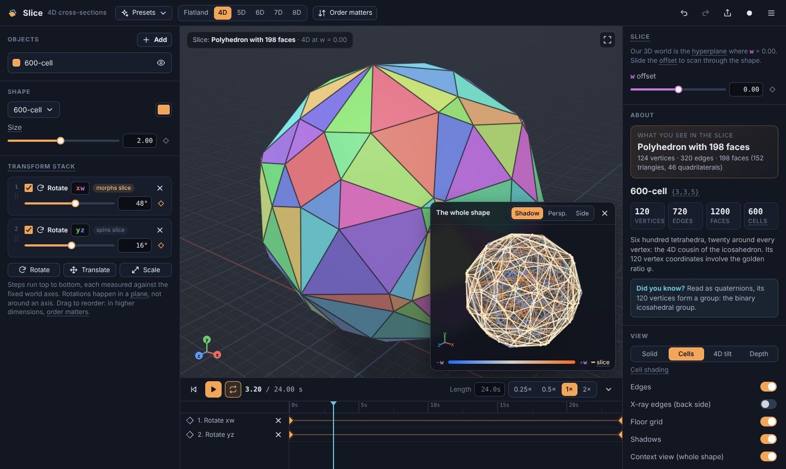

# Slice

An interactive tool for building intuition about 4D (and n-D) geometry. Put a
high-dimensional shape in the scene, turn it, and watch what a 3D being would
see: the **3D cross-section** where the shape meets our 3D world. It is
Flatland one dimension up. A sphere passing through a 2D world looks like a
circle that grows and shrinks; a hypersphere passing through ours looks like a
sphere that grows and shrinks.



## Getting started

```bash
npm install
npm run dev        # http://localhost:5173
npm test           # unit tests (math, slicing, shapes, animation, persistence)
npm run build      # typecheck + static production build in dist/
npm run lint
```

Needs a browser with WebGL2 (any current desktop or mobile browser).

A good first five minutes:

1. The app opens on **Tesseract: xw spin**. The rotation is in the
   **xw-plane**, which mixes our x-axis with the hidden w-axis, so the cube you
   see stretches, grows new faces and turns back into a cube every quarter turn.
2. Press **+ Rotate** and pick **xy**: that rotation just spins the slice like
   an ordinary 3D object, because it never touches w.
3. Drag the **w offset** slider on the right to scan through the shape.
4. Open **Presets → Tesseract: diagonal scan** to watch a tetrahedron become an
   octahedron and back.
5. Click **Order matters** and press **Swap order on B**.

## What's in it

The phases of the design doc, and where each lives:

| Phase | Feature | Status |
| --- | --- | --- |
| 1. MVP | Hypersphere and tesseract, SDF slice rendering, rotate in all 6 planes, translate, scale, slice offset, orbit camera | ✅ |
| 2. Context | Context ("ghost") inset: projection of the whole shape with the slice drawn in place, in three projections (shadow, perspective, side). Reorderable transform stack | ✅ |
| 3. Library | All six regular 4D polytopes (5-cell, tesseract, 16-cell, 24-cell, 600-cell, 120-cell), info panels, glossary tooltips | ✅ |
| 4. Timeline | Keyframes on every number, per-key easing, play / scrub / loop / length / speed, 21 presets | ✅ |
| 5. Exotic shapes | Duocylinder, Clifford torus, spheritorus, torisphere, ditorus, spherinder, cubinder, hypercone, p,q-duoprisms, polyhedral prisms, Klein bottle (thickened, embedded in 4D), Hopf fibration view | ✅ |
| 6. n-D | 4D to 8D: one slice offset per hidden axis, every rotation plane, n-cube / n-simplex / n-orthoplex / n-ball families. Flatland mode (3D shapes sliced to 2D) | ✅ |
| 7. Output | Video export (WebM, one timeline loop), PNG export, share links, scene files | ✅ video · ❌ VR |

Not done yet: VR (WebXR), the last item of the design doc's roadmap.

Learning features:

- **Live slice readout**: the slice of a polytope is computed exactly and
  named as it changes ("Truncated tetrahedron", "Cuboctahedron", "Hexagonal
  prism", "Polyhedron with 198 faces (152 triangles, 46 quadrilaterals)").
  Hypersphere slices report their radius √(r² − d²).
- **Shape info**: vertex/edge/face/cell counts, Schläfli symbol, a plain-language
  description and a fun fact.
- **Glossary tooltips** on every term (plane, hyperplane, slice, cell, commute, …),
  plus a glossary page.
- **Order matters** lesson: two copies with the same two rotations; swap the
  order on one copy. xy & zw commute, xy & yz don't. The verdict is computed
  from the actual matrices.
- **Shading modes**: *Cells* (each face coloured by the 4D cell it was cut
  from), *4D tilt* (how the surface leans into the hidden direction), *Depth*
  (where the point sits along w in the shape's own frame).
- **Flatland mode** is the warm-up analogy: the same app one dimension down.

## How it works

### Rotations happen in planes

Every transform is an (n+1)×(n+1) homogeneous matrix, built from the stack in
list order (`M = M_k ⋯ M_1`, each op relative to the fixed world axes), with an
exact inverse composed from per-op analytic inverses. A rotation is a plane
`(a, b)` plus an angle, and only coordinates a and b change. Nothing in
`src/math` assumes a dimension.

### From a pixel to n-D

Our visible world is the k-dimensional slice (k = 3, or 2 in Flatland) where
every hidden world coordinate equals its slice offset. For an object with
world→shape transform `M⁻¹`, a slice point `q` maps to shape space as
`p = L q + t0` (an affine map; `src/math/slice.ts`). Every pixel's ray lives in
our 3D world, and each point on it is evaluated in shape space through that map:

- **Polytopes** are intersections of half-spaces `n·p ≤ b`. Through the affine
  map each facet becomes a 3D half-space. The ray is intersected with all of
  them analytically (entry = max over front-facing planes, exit = min over
  back-facing), so silhouettes are exact. Edge lines come from the in-face
  distance to the nearest neighbouring plane, with analytic anti-aliasing.
- **Curved shapes** are signed distance functions written once in a tiny
  expression language (`src/math/sdf.ts`) that compiles both to GLSL and to
  JavaScript. The shader is generated per scene. Sphere tracing uses
  the n-D distance bound scaled by the transform's smallest singular value,
  which keeps it conservative under non-uniform scaling. A gradient check near
  the surface stops thin slices from looking fat.

- **Thickened surfaces** (the Klein bottle) meet our world along a curve.
  Marching squares on the surface's (u, v) parameter grid finds that curve
  each frame. The pieces are chained, grouped into chunks with bounding
  spheres, and intersected analytically as capsules, so the slice is a crisp
  tube.

The **Hopf fibration** is a separate view (Presets → Special views): the
3-sphere split into great circles, stereographically projected into 3D,
where every circle is exact. Instanced tubes are drawn with MSAA, and every
pair of circles links once (a unit test checks the Gauss linking integral).

### Exact slices on the CPU

For polytopes the app also computes the exact slice polytope every frame. It
restricts the facets to the slice, finds a deep interior point with a
Chebyshev-center LP (a dual simplex with only k+1 rows, so it stays fast even
for the 600-cell), dualizes the half-spaces to points and takes a 3D convex
hull. Hull vertices are the faces of the slice, and hull facets are its
vertices. This works for any dimension and any number of hidden axes. It feeds
the shader with only the planes that matter, the live classification, the
context view and the floor shadows. A 600-cell slice takes about 4 ms in the benchmark.

### Rendering details

Progressive anti-aliasing (jittered accumulation) when the view is still,
adaptive resolution while things move, camera-relative lighting, soft shadows
for curved shapes and analytic shadow polygons for polytopes.

## Correctness checks (design doc §9)

All of them are unit tests (`src/shapes/slice.test.ts`, `src/math/math.test.ts`):

- Tesseract at w = 0 → cube; perpendicular to the long diagonal → regular
  octahedron (and tetrahedron / truncated tetrahedron further along the scan).
- 16-cell at w = 0 → regular octahedron; 24-cell at w = 0 → cuboctahedron.
- Hypersphere radius r at w = d → sphere of radius √(r² − d²), empty for |d| > r.
- Every rotation matrix in 3D–8D is orthogonal with determinant 1.
- xy·zw = zw·xy; xy·yz ≠ yz·xy.
- A 90° xw rotation of the tesseract gives a cube again at w = 0.

The slicer is also cross-checked against brute-force vertex enumeration on
random transforms of several polytopes in 4D and 5D. Every preset is tested to
build a valid scene that shows something.

## Project layout

```
src/
  math/       pure, dimension-agnostic maths (vectors, matrices, transforms,
              eigen/SVD, LP, 2D/3D hulls, polytope slicing, SDF expressions)
  shapes/     shape library (polytopes, curved shapes, wireframes, info text,
              slice classifier)
  scene/      scene model, keyframe animation, per-frame evaluation, store
              (undo/redo), presets, persistence
  render/     WebGL2 renderer + shader generation, orbit camera, context view,
              click picking, video recorder
  ui/         React UI
```

## Controls

Drag to orbit · scroll/pinch to zoom · right-drag, shift-drag or two fingers to
pan · click a shape to select it.
<kbd>Space</kbd> play/pause · <kbd>Home</kbd>/<kbd>End</kbd> · <kbd>←</kbd>/<kbd>→</kbd> step ·
<kbd>Ctrl</kbd>+<kbd>Z</kbd> / <kbd>Ctrl</kbd>+<kbd>Shift</kbd>+<kbd>Z</kbd> undo/redo ·
<kbd>F</kbd> reset view · <kbd>1</kbd>–<kbd>4</kbd> shading · <kbd>?</kbd> help.

Debug URL flags: `?samples=1` (no accumulation), `?scale=0.5` (fixed render
scale). Both are handy on software GL.
